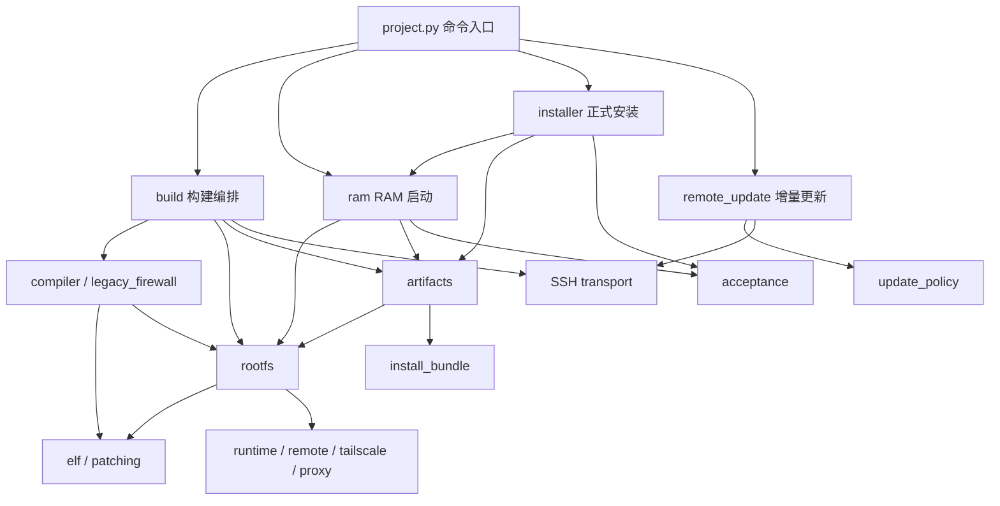

# CM201-2 项目整理、合并与源码发布设计

日期：2026-11-01（Asia/Shanghai）

状态：已通过独立可实施性复核，待用户审阅；本文描述拟实施方案，不代表问题已经修复或版本已经发布。

## 1. 目的与范围

本轮目的是将当前网络扩展分支整理成职责清楚、可审查、可回归、适合公开发布的版本，再合并到 `main`。整理覆盖代码架构、重复实现、模块耦合、功能归属、隐私边界和交付流程。

用户已经要求最终合并并发布，并在范围确认时选择了“先审阅完整重构设计”。本阶段只审查现状并形成设计；设计确认之后再编写实施计划、修改产品代码、提交功能改动和执行发布。

本设计提出以下交付边界，供此次审阅确认：

- 保持 Python 3.12、Zig 0.13.0、原厂 3.18 内核、ucode、fw3/iptables legacy 技术栈。
- 保留现有 CLI 名称、设备安装路径、UCI 包名、RPC 方法、默认停用策略及网络事务语义。
- 公开交付源码、测试、模板、资源锁、说明和经核对的公开资源元数据。
- 固件、原厂参数、设备配置、口令摘要、设备密钥、订阅和现场日志继续保留在本机。
- 仅因本轮整理，不连接或修改现场设备，不执行刷机、重启、登录 Tailscale、更新 DDNS 或启用代理。
- 本轮不扩展 SFT1200 支持，不改防火墙后端，不升级无线包，不重新设计代理业务。

成功标准是：发布阻断问题修复、模块依赖收敛、公共克隆的测试可运行、提交和发布附件通过隐私检查，且发布说明准确区分代码测试与实机验收。

## 2. 审查基线与证据

| 项目 | 本次确认结果 |
| --- | --- |
| 工作分支 | `codex/remote-networking`，审查起点 `1bf6370` |
| 本机 main | `4cb6fed`；合并前仍须重新取得远端最新状态 |
| 已有未提交内容 | 18 个已跟踪文件修改、64 个未跟踪文件；不能只审查 `HEAD` 间的 diff |
| 公开候选范围 | 102 个已跟踪文件，加 64 个未跟踪候选，共 166 个 |
| 远程仓库 | GitHub 连接器将旧地址解析为 `588q9/IPTV-cm201-2-OpenWRT`，公开仓库，当前账号有推送权限 |
| 公共 Python 回归 | Python 3.12.14：运行 135 项，结果 OK，Windows 跳过 2 项 Linux 专属测试 |
| 直接执行的 Node 入口 | 当前 CI 中 6 个入口全部通过；Python 测试还覆盖其他 Node fixtures |
| 当前文件隐私检查 | 未命中私钥、常见 GitHub/Tailscale 凭据或本机配置中的实际密码；命中项为测试字符串和第三方署名 |
| Git 历史检查 | 检查 281 个历史文本 blob，私钥、常见 GitHub/Tailscale 令牌及 URL 内嵌账号口令规则均无命中 |
| 固定资源 | 59 项缓存文件均存在；审查中核对了两份冲突索引的锁定摘要，未重新校验全部缓存内容 |

这些结果是本机审查证据，不代表 Windows/Linux 远端 CI、本轮交叉编译、全新下载、真实 TLS、设备升级、uhttpd 链接读取、真实业务或长期稳定性已经验收。规则扫描也不能证明不存在任何秘密；最终提交树和附件还须重新检查。

安全与架构审查分别由独立审阅者完成；关键更新包问题由主审使用 Python 3.12、临时文件及模拟 SSH 再次复现。设计完成后，另一位独立审阅者检查了依赖方向、旧包兼容和无设备操作的发布门禁，未发现需要补充回答的关键实施问题。

本机 Git 访问远端时，原代理端口不可连接；单次命令绕过代理也没有连通。连接器可以读取仓库元数据。合并实施时应先解决或绕过这条传输限制，不修改用户全局代理配置，不把旧的本机远端引用当作最新状态。

## 3. 已确认问题与优先级

| 编号 | 优先级与问题 | 证据与实际影响 | 处置 |
| --- | --- | --- | --- |
| S1 | P1：增量包检查执行包内脚本 | `remote_update.py:93–114` 只校验清单中的 payload，然后解包原始归档并执行包内 `update`。本地模拟确认，替换 updater、加入清单外文件仍能到达默认 `check` 执行路径；未连接设备。检查本身可能变成设备 root 任意执行。 | 发布前修复 |
| S2 | P2：更新链接可以指向私密文件 | `remote_update.py:14–17` 只约束 GeoIP 特例；设备 `network-update.uc:55–57` 对一般链接只检查类型和 NUL。本地内存构造确认 `www/leak -> /etc/shadow` 能进入合法包；实际 HTTP 读取尚未验证。 | 发布前修复 |
| S3 | P2：构建中间归档权限不私密 | `build.py:363` 未显式建立 0700 作业目录；`device/build-job:3,58` 未设置私密 umask。继承 022 时，含 AP 密码和 root 摘要的结果归档可能被设备其他本地账户读取。 | 发布前修复 |
| R1 | P2：全新缓存无法同时从一个现行 URL 取得两份旧索引 | `resources.lock.json:64,550` 的 URL 相同，但大小与 SHA256 不同。旧索引仍用于锁定无线 r5 包；新索引含 r6，且同版本 wifi-scripts 的内容标识也变化。不能直接删旧索引。 | 明确不可变取得方式，或明确可信缓存前提；禁止宣称全新下载已复现 |
| A1 | 结构性耦合：底层工具反向依赖编排模块 | `legacy_firewall.py:125` 从 `build` 取路径解析；`ram.py:11` 从 `build` 取常量、seed、校验；`installer` 和 `ram` 通过延迟导入互相调用。 | 分阶段抽取底层职责 |
| A2 | 实际重复：失效的包选择路径 | `build.py:32–39,342,346` 生成 `packages.list`，当前设备作业实际读取 `apk-constraints.list`。 | 删除失效生成路径，保留实际内容标识约束 |
| A3 | 资源与许可元数据可能漂移 | curl 源码根目录同时硬编码在 `compiler.py:148` 和 `remote_assets.py:83`；头文件目录可能保留旧内容。`remote_assets.py:78` 遇到缺失许可锁项直接跳过。 | 来源集中、缓存按输入失效、必需许可缺失即失败 |
| A4 | 恢复命令被无关构建资源阻塞 | `project.py:67–70` 在 `restore` 前验证全部下载和原厂输入；`restore_internal` 实际只需串口配置和串口依赖。 | 按命令加载真正所需输入 |

其他核对结果：代理 status 只返回“是否保存订阅”，没有返回订阅 URL 或 API 密钥；错误走固定消息映射。Tailscale 状态排除了 AuthURL、身份和 peers；SSH 强制校验 known_hosts。上述防护应作为兼容约束保留。

代理 API 密钥实际也存在于权限受限的 active/candidate/previous/事务 JSON 中，页面“只保存在 secret 文件”的说法不准确，应改为“只在设备私有配置及事务备份中保存”。订阅 YAML 解析已有 CPU/时间限制，但 JSON 输出在完整写入、读入后才检查 8 MiB 上限；加强解析资源上限列为后续加固项，本次没有验证 ARM yq 的最坏资源行为。

## 4. 方案比较与推荐

| 方案 | 内容与代价 | 判断 |
| --- | --- | --- |
| 只修发布问题 | 修复 S1–S3、资源取得说明和隐私门禁，基本不移动模块；改动最小，但保留现有循环依赖和职责混杂。 | 可作为紧急补丁，不完全满足本次整理目标 |
| 分阶段整理现有架构 | 先封闭安全边界，再抽取已有底层能力、收敛配置和资源来源、整理功能入口；保留外部接口并逐阶段回归。 | **推荐**，兼顾本次架构整理和发布可靠性 |
| 重写统一框架 | 新建插件注册系统、统一所有事务引擎、重写网络控制面或迁移包结构；测试和实机重验范围显著增大。 | 不纳入本轮 |

用户目前确认的是先审阅设计，尚未确认具体架构方案。本文件的模块命名、拆分粒度、发布类型和资源快照建议均为设计提案，不冒充已达成的决定。

## 5. 功能归属

| 功能域 | 当前主要位置 | 整理后唯一职责与边界 |
| --- | --- | --- |
| 原厂档案与配置 | `profile.py`、`hardware.py`、`layout.py` | 核对原厂输入、设备几何和本机设置；不承担功能服务编排 |
| 资源准备 | `resources.py`、`resources.lock.json` | 资源来源、路径、长度、摘要和缓存；只有 prepare 下载 |
| ARM 编译 | `compiler.py`、`legacy_firewall.py` | 从已验证的本地输入生成工具；ELF 和补丁算法下沉为独立能力 |
| 根系统构造 | 当前 `build.py` 的 seed/overlay 与根校验 | 组合官方根、原厂支持、运行时和默认配置；不访问串口/SSH |
| 产物组装与校验 | 当前 `build.py` 的组装、verify | tar/cpio/boot/manifest 一致性和安装包生成；不启动设备作业 |
| 构建编排 | `build.py`、`device/build-job` | 编译、RAM 作业、前后快照、取回结果、调用产物组装 |
| RAM 验收与正式安装 | `ram.py`、`installer.py` | 保留不同操作入口，验收凭据独立；安装继续要求显式擦除开关 |
| 基础无线和网络 | `runtime.py`、`configs/templates/cm2012-*` | AP/STA、LAN/WAN、路由、原网络事务和回滚 |
| Cloudflare DDNS | `remote.py`、官方 DDNS 包/LuCI | 默认配置与依赖声明；继续使用官方控制面 |
| Tailscale | `tailscale.py`、Tailscale templates | 默认配置、设备服务、受限 RPC、来源与管理端口政策 |
| Mihomo 代理 | `proxy.py`、`configs/remote-proxy/` | 订阅策略、事务、设备 I/O、LuCI；保留 lib/service/native 分层 |
| 增量安装与撤销 | `remote_update.py`、设备 updater | 生成、验证、部署、基线比较和精确撤销；不改 APK 总数据库或分区 |
| 历史评估 | `tools/network-assessment/` | 只作历史归档，保持与正式入口、测试发现和发布自动化隔离 |

三个网络扩展功能继续独立启停；生命周期协调器只调用明确的 suspend/reconcile 接口，不读取各服务私密状态，也不直接编辑它们的事务文件。

## 6. 模块拆分与依赖方向

采用少量职责明确的模块，直接搬移现有算法。新名字为提案，实施时可在不改变职责的前提下微调。

| 拟调整位置 | 内容 | 消除的耦合 |
| --- | --- | --- |
| `elf.py` | 从 compiler 移入 ELF 解析和检查 | 根校验、legacy 编译不再为了 ELF 工具依赖完整 compiler |
| `patching.py` | 从 compiler 移入严格补丁应用 | legacy 编译不再回调 compiler 获取底层算法 |
| `rootfs.py` | 移入链接解析、根校验、secret stripping、make_seed、make_overlay | legacy、RAM、产物校验不再反向依赖 build |
| `artifacts.py` | 移入 assemble_outputs、verify_output | 校验入口不再加载构建/传输编排 |
| `install_bundle.py` | 移入 root_digest、make_install_env、install_archive | 产物生成不再依赖会执行安装的 installer |
| `acceptance.py` | 移入 RAM_CHECKS、record_ram_acceptance 和凭据格式检查 | ram 不再导入 installer，installer 只消费验收结果 |
| `images.py` | 统一保存已有默认 CMDLINE 常量 | 启动格式相关代码不再从 build 取常量 |
| `update_policy.py` | 主机端更新清单 schema、路径与链接规则 | 更新验证和传输分开；为设备规则提供同一份声明式输入 |



图省略公共底层 `resources/archives/images/layout/hardware` 的连线。关键约束是这些底层模块、rootfs、artifacts、验收和打包模块都不反向导入 build/installer/ram。验收模块可以进行只读串口检查，但不调用安装和重启。相应模块的全局导入不能连接设备或打开串口。

原模块中已有、被测试或内部调用使用的导入路径，可暂时显式再导出以保持兼容；再导出只允许上层指向底层，不能重新引入环。旧代码必须删除，不能留下两份实现。通过不同行为入口的导入烟测和现有回归确认依赖方向，不为单个私有函数搬家编写镜像式测试。

## 7. 去重与可维护性整理

1. 删除无消费者的 `locked_packages/packages.list` 路径，以现有 APK 内容标识约束为唯一选择依据；禁止退回只按包名/版本选源。
2. 保留 runtime、remote、tailscale、proxy 的小型组合函数。统一模板记录为“源文件、目标路径、权限”，共用一个小型读取函数；不建立通用插件框架。
3. 统一 `configuration()` 负责 UCI 默认配置、`runtime_files()` 负责脚本/UI/ACL/链接。清除 Tailscale 配置被重复合并的差异，但保持最终根系统内容与权限一致。
4. 功能之间的合并对冲突目标失败；显式 rootfs overlay 覆盖官方文件仍保留，并记录所有权。相同父目录的补齐不视为冲突。
5. curl 的归档根/头文件来源/许可路径从一个受校验的资源描述取得；只提取唯一合法顶层目录。头文件缓存绑定源码 SHA256，切换输入时在已验证的工作区边界内重建，缺少必要头文件立即失败。
6. 必需许可资源与可执行资源一样强制存在并校验；第三方版本变更同时更新锁、来源和许可记录。
7. 保留现有代理 lib（策略）、service（事务）、native（设备 I/O）职责，先改善公开接口和关键段落可读性。DNS、规则、恢复语义的进一步拆分不与本次安全修复绑在一起。

不以减少行数为验收标准。只删除已证明失效的路径；将有行为差异的网络事务强行抽成通用引擎不属于本轮去重。

## 8. 增量更新的安全设计

### 8.1 主机验证与设备执行

新流程为：读归档 → 解析并严格校验 → 重新生成规范归档 → 建立私密 SSH 作业 → 运行本地受信 updater。任何失败都应发生在创建 SSH 连接之前，除非属于目标设备基线检查。

- 仅接受 format 1 及规定字段，校验非空 files 对象、规范相对路径、记录类型、权限、摘要和 before/after 结构，拒绝特殊文件、重复路径、别名路径和未知非目录条目。
- 必须核对每个 payload 与清单一一对应；额外的文件、脚本、链接、设备节点和不可解释目录均拒绝。对总体积、条目数和解压内容设置与现有包规模相称的上限。
- 兼容旧包中原本附带的 updater 文件名，但不执行其内容；规范包中的 updater 始终由当前本地受信源码注入。上传的 bytes 必须是规范重打包结果，不能继续上传原始输入。
- `check` 允许本次 RAM 作业目录和检查输出，不修改持久配置、不启动/停止服务；`install/rollback` 保留现有写入锁、基线校验、备份完整性及并发修改保护。
- 验证错误不回显负载内容或远端原始异常；失败诊断目录保留 0700，成功后只清理本次已验证的 UUID 作业目录。

清单内的 SHA256 只证明负载与清单一致，不能证明发布者身份。`install` 仍只接受操作者信任的本地生成/已核验包；本方案不宣称可以安全安装任意不可信 root 程序，也不新增未设计的远程自动更新渠道。

### 8.2 路径和链接策略

- 保持现有引导、原厂模块、固件、APK 总数据库及私密状态路径禁区。
- Web 目录的新增/替换链接全部拒绝；当前本地 Dashboard 采用普通静态文件，不需要通过增量包创建 Web 链接。目标父目录也必须逐级验证，拒绝链接目录。
- 其他链接先按 POSIX 语义规范化目标，拒绝根外路径、控制字符、循环及经过禁区的链；只允许声明的公共程序/库、服务链接和证书目录间的必要映射。
- 保留现有 GeoIP 固定目标例外，保留合法的 rc.d→init.d、程序和库链接。对需目标设备才能判断的链，由受信 updater 在写入前复查；无法判断时拒绝。
- 已有 before 链接记录用于精确恢复；不把历史链接本身当作可任意新建的许可。若恢复会重建危险链接，撤销应失败并保留备份，交由操作者检查。
- 主机策略和设备策略由同一份公开声明式数据定义允许根、禁区和固定例外；设备语言特有的校验代码继续独立实现，并用同一组正反例验证一致性。

## 9. 隐私与发布内容控制

### 9.1 运行时私密数据

- 创建构建和更新目录时显式 `umask 077`、目录 0700；设备 build-job 自身再次设置 umask，校验作业目录非链接且为本次受控路径。
- seed、payload、result、快照和诊断文件在私密目录中保存；含真实配置的数据即便只是临时文件，也不得成为公开附件。
- 保留订阅 URL 通过私密文件传递的方式，避免进入命令参数；RPC/status/错误继续输出受控字段。
- 不自动删除旧现场诊断或备份。用户本机历史文件的清理由独立操作完成，不能以“未跟踪”推断“无用”。

### 9.2 持续公开检查

拟新增独立检查入口，检查实际 Git 索引/发布树，而不是把整个工作目录当作公开内容。

- 对目录、文件名、私钥、常见 token、URL 内嵌口令、明显真实凭据格式做高置信度检查。
- 对人工测试口令使用局部、精确的样例许可；不为整个 tests 或 docs 关闭扫描。第三方署名邮件保留版权来源。
- 日志只输出规则、文件和行号，不输出匹配值；本机已知私密值比对只在本机运行，不将值、摘要或配置复制进 CI。
- CI 检查每个 PR/推送的公开树；发行前额外检查完整待合并差异和打包清单。若发现历史泄露，先停止发布并确定密钥撤销范围，不能只删除当前行后宣称完成。
- 保持仓库白名单，精确允许新增模块、文档和公开元数据；凭据文件、私钥、输出、缓存、备份和现场日志继续排除。
- 二进制公开元数据仅允许明确记录来源和摘要的索引快照；扫描不能因为文件不可解码就无条件跳过。普通测试工作流使用只读仓库权限，不注入设备凭据；发布权限只给予专门的发布步骤。

## 10. 固定资源与首次准备

保留当前旧/新签名索引及无线包身份。设计优先采用“小型公开签名索引快照随源码保存”：为 5 份 packages.adb 使用独立、精确放行的目录，合计约 1.30 MiB，记录原 URL、取得日期、完整 SHA256、对应 feed 和来源说明。

`prepare` 可先从显式 bundled source 复制到原缓存路径，复制前后均核对锁定大小和摘要；网络仍只使用 HTTPS。源码和许可记录核对完成后才纳入这些公共元数据，原厂资料和设备 APK 数据库绝不能混入。快照本身保留原始签名字节，设备 APK 继续按原机制验签。

这解决“两份历史索引共用现行 URL”的冲突，不保证所有历史 APK/源码在上游长期可下载。其余资源继续采用明确的可信 `--import-dir` 或锁定 URL；缺失、漂移均失败，不改摘要、不自动升级、不回退到当前镜像。

若公开索引快照的来源记录无法核对，实施者保留原输入并如实说明可信缓存前提，不以删旧索引代替解决。干净网络准备成功只能在实际测试后写入验收结论。

## 11. CLI 按功能加载依赖

| 命令 | 必需输入/能力 | 整理目标 |
| --- | --- | --- |
| prepare | 资源锁、网络或可信导入目录 | 准备资源，不读取设备配置 |
| configure | 原厂输入、口令输入、所需密码库 | 建立本地档案，不连接设备 |
| check | 资源锁、本地档案、原厂输入 | 保持完整离线核验 |
| check --device | 上项加串口 | 保持只读硬件核验 |
| build | 锁定缓存、编译器、原厂档案、选定传输 | 保持 RAM 隔离构建 |
| verify | 当前产物、本机档案、必要原厂输入 | 校验产物不加载全部下载缓存或串口库 |
| ram-test | 对应 bootstrap/完整 RAM 输入及串口 | 保持原有启动和只读校验门槛 |
| install | 已校验产物、验收凭据、原厂档案、串口 | 保持显式擦除参数和安装边界 |
| restore | 本地串口设置及串口运行依赖 | 不因无关的面板/代理下载缓存缺失而无法恢复 |
| network-bundle | 已校验 rootfs、SSH、本次只读快照 | 不读取不相关原厂输入 |
| network-deploy | 更新包、更新策略、SSH | 验证完成再连接设备，保留显式 action |

拆分本地设置读取与原厂输入读取，针对命令显式调用；保持现有 CLI 名称、参数和默认 action，帮助文本同步表达副作用。

## 12. 分阶段实施与回退

| 阶段 | 内容 | 阶段验收与回退边界 |
| --- | --- | --- |
| 0：保全当前成果 | 记录当前修改与未跟踪清单，私密证据留 local；确定实际工作树及远端 main 状态 | 无 reset/clean/覆盖用户文件；先核对完整提交范围 |
| 1：修复发布阻断 | S1–S3、主机/设备更新政策和回归 | 恶意包必须在 SSH 前拒绝；合法旧包与撤销仍通过 |
| 2：抽取底层职责 | ELF、补丁、rootfs、artifacts、install_bundle、acceptance | 每批可独立提交和撤销；合成输入下默认文件内容/权限保持一致 |
| 3：清除重复与依赖 | 失效包清单、模板合并、curl 元数据、许可必需项、CLI 依赖 | 已有回归通过；新回归覆盖真实边界，不为机械搬家逐函数加测试 |
| 4：公开交付治理 | 快照处置、隐私检查、功能索引、README、第三方说明和 release notes | 全新公共克隆可运行纯测试；公开树与附件清单可审查 |
| 5：合并与发布 | 独立复核、远端 CI、合并 main、源码 tag/Release | 所有必需门禁通过才合并和发版；核对目标 SHA 与远端完成状态 |

代码按阶段提交，安全修复和纯搬移分开。现有未提交网络扩展内容先纳入审查与来源记录，再组织提交；不把所有本地文件批量加入 Git。工作树隔离方式由实施者根据现有未提交状态决定，必须保留用户当前成果，不自动删除原分支。

回退以 Git 提交为单位。发布前错误撤销相应整理提交；发布后普通修复使用新提交/新版本，不改写已公开历史或覆盖已发布 tag。对现场设备的升级与撤销不属于本轮自动发布操作。

## 13. 验证与合并门禁

| 验证层 | 必须证明的行为 |
| --- | --- |
| 安全回归 | 篡改 updater、清单外条目、畸形记录、特殊文件、路径别名、危险链接/链/循环在允许的最早阶段拒绝；错误无秘密内容 |
| 更新兼容 | 合法旧包可规范化检查；基线漂移、并发写、备份损坏、安装后修改仍阻止不安全安装/撤销 |
| 架构回归 | 关键模块可独立导入且无设备副作用；搬移后合成镜像中必要文件、链接、权限、清单和摘要关系保持一致 |
| CLI 回归 | restore 不依赖无关缓存；verify 不要求下载全部资源；build/install 的输入校验不被放宽 |
| 资源与许可 | 签名索引快照按摘要导入；缺失/篡改/错误顶层/旧头缓存/缺失许可均有明确失败行为 |
| 公共测试 | Python 3.12 和锁定 Node 在 Windows、Ubuntu 运行现有全部公共回归及新增边界回归；记录 skips 原因 |
| 编译集成 | 已准备锁定缓存下运行 opt-in compiler integration；证明当前 ARM 辅助程序可由当前源码编译，避免仅测模拟器 |
| 隐私与附件 | 索引、最终 commit tree、源码发布包分别通过规则/人工核对；没有 local、输出、原厂参数、配置、密钥和现场日志 |
| 发布状态 | 远端 main 指向已审查提交；必需 CI 成功；tag 对应核定 SHA；Release 页面可读取且附件摘要与打包记录一致 |

测试命令沿用现有入口：

```powershell
py -3.12 -m unittest discover -s tests -p "test_public_*.py" -v
$env:CM2012_RUN_COMPILER_INTEGRATION = '1'
py -3.12 -m unittest discover -s tests/integration -p test_compiler.py -v
Remove-Item Env:CM2012_RUN_COMPILER_INTEGRATION
```

集成测试仅使用本地锁定源码/缓存，不连接设备。公共 CI 保持无需私人输入；不把所有可选设备测试一概标成通过。真实 TLS、规则集合完整准备、DDNS 更新、Tailscale 登录/蜂窝访问、实际转发、重启恢复和长期负载需要独立设备验收；本轮源码发布如实列出已有证据和未验收项。

## 14. 文档与发布提案

- README 首页改为当前功能、开始入口、限制和验证状态；日期流水移入独立变更记录，移除“本分支”作为正式首页的长期结构。
- 新增一份项目架构与功能索引，按本设计第 5 节提供代码、配置、入口、测试和使用说明对应关系。
- 已有现场记录保留原日期与证据范围，链接到最新说明；不把旧设备验收改写为本次重构后的验收。
- THIRD_PARTY 记录快照、资源、许可证和修改范围，必需许可与构建清单一起核对。
- 首次拟发布 `v0.2.0-rc.1` 源码预发布；创建前检查远端 tag 是否占用，若占用选择下一个未使用 rc 号，不移动旧 tag。采用预发布是因为本次只有代码层验收，网络扩展仍有未完成的完整业务/长期验收。
- Release 只指向合并后的核定 commit，包含功能摘要、修复、升级/回退边界、验证记录和已知限制；附件仅从提交树生成，附内容清单和 SHA256，不打包工作目录。
- 合并前读取仓库的实际保护规则并遵守所需 PR/检查，不绕过保护。使用 PR 时在远端 CI 成功后核对 head SHA 再合并；发布 tag 必须对应已合并到 main 的核定提交。
- 使用连接器可完成的仓库操作优先使用连接器；缺失的 Release/传输能力使用 Git 或 GitHub 官方 API/Actions。推送失败、CI 失败或 Release 未创建时，明确报告停在哪一步，不能把本地提交当作已经发布。

若用户希望正式稳定版而不是源码预发布，需要先补足相应设备与业务验收；这属于本设计明确的范围变化，不由实施者擅自作出“稳定”结论。

## 15. 待审阅决定

建议批准“分阶段整理现有架构”：按阶段 1–4 整理与验证，再按阶段 5 合并和发布上述源码预发布。具体函数命名、兼容再导出和文件搬移次序交由实施者决定，以接口兼容和测试证据为准。

审阅时最影响实施范围的两项提案是：采用上述具体模块拆分，以及首次交付采用源码预发布。除此之外，不需要用户逐条决定内部实现细节。

本文审阅通过之后，下一份交付是基于该设计的实施计划；该计划应列出实际文件、变更顺序、验证命令和每阶段完成条件。
