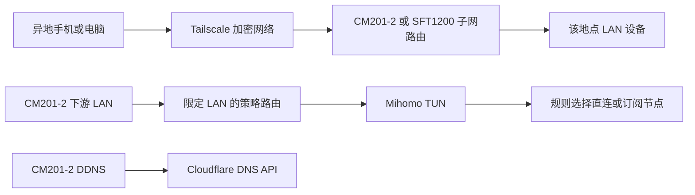

# CM201-2：DDNS、异地访问与 LAN 自动分流方案

设计日期：2026-10-18。本文保留当时的技术选型、实施设计及验收门槛；当时尚未安装常驻服务，部分 Tailscale 实机检查见 [双路由兼容性评估](Tailscale双路由兼容性评估.md)。

2026-10-21 更新：CM201-2 已完成三项服务、LuCI、离线构建及 SSH 增量安装，业务功能默认停用；实机隔离 TUN/API/DNS、原生 UCI/fw3 规则和增量撤销后重装已验证。账号授权、真实客户端与蜂窝访问、重启及长期运行尚未验收。当前状态和操作以 [CM201-2 网络扩展实施与启用](CM2012网络扩展实施与启用.md) 为准；SFT1200 留待后续独立研究。

## 1. 已确认需求与交付边界

- 现有设备为本项目 CM201-2 和另一地点的 GL-SFT1200（Opal）。没有公网入站入口，不增加 VPS，先做技术验证。
- 手机／电脑安装 Tailscale 后访问异地 LAN；本阶段不要求两地 LAN 主动双向互访。
- CM201-2 增加 Mihomo，使用已有 Clash/Mihomo 订阅，让以盒子为默认网关的 LAN 设备自动分流，无需逐台设置代理。
- 已有 Cloudflare 域名，增加 DDNS 和 Web 配置入口；域名、Token、订阅地址在部署时本地填写。
- 第一阶段仅覆盖 IPv4。Tailscale、DDNS 与代理分别启停；SFT1200 首轮只评估 Tailscale，不叠加 Mihomo。
- 本文设计内容不能替代实机验收，也不提供可直接无条件执行的全量路由命令。设备事实、用户凭据、实际网段及兼容性门槛须在实施时取得；CM201-2 本轮交付与未验收范围见上述实施记录。

LAN 自动分流的必要条件：终端的默认网关和 DNS 指向 CM201-2，或下游 AP 桥接到 CM201-2 的 LAN。当前盒子历史记录为 Wi-Fi 上联、eth0/ap0 桥接 LAN；这不是本次实机读取结果。只把盒子接入现有主路由的 LAN，并不会自动接管其他终端流量。

术语约定：这里的代理目标是“路由器端透明代理／网关自动分流”。LAN 上网终端只需正常通过 DHCP 联网，不安装代理客户端、不填写 HTTP/SOCKS 代理。TUN 在路由器的 IP 层接收选中的流量，再交给 Mihomo 等用户空间核心处理 TCP/UDP 连接并选择直连或远端代理；IP 层接管和代理协议所处层次是两个维度。不能把“应用层代理核心”理解为“必须在终端应用设置代理”，也不能把 TUN 自动等同于可传输任意 IP 协议的三层 VPN。异地访问所需的 Tailscale 客户端属于另一项功能，不是 LAN 终端代理上网的前提。

## 2. 技术选型

| 功能 | 选择 | 适配原则 |
| --- | --- | --- |
| 异地 LAN 访问 | Tailscale，正常 TUN 子网路由 | 使用官方用户空间程序，不依赖 WireGuard 内核模块 |
| 代理与分流 | Mihomo（Clash.Meta） | 首选独立 TUN、项目管理策略路由；匹配已有订阅 |
| 代理 Web | MetaCubeXD，加项目 LuCI 配置页 | Dashboard 管节点和连接；LuCI 管订阅、透明模式及恢复 |
| DDNS | ddns-scripts、ddns-scripts-cloudflare | HTTPS API Token，复用标准 UCI 服务 |
| DDNS Web | luci-app-ddns | 在现有 LuCI 内管理 |
| 系统管理 | 现有 LuCI、procd、fw3/iptables legacy | 保留原厂内核、无线服务及现有网络事务 |

Tailscale 首轮候选版本固定为 1.104.1；Mihomo 首轮候选版本固定为 v1.19.32。CM201-2 已通过 Tailscale 的隔离 TUN/daemon 初始化，SFT1200 已通过官方程序版本与独立 TUN ioctl 测试；两台均未验证登录及真实子网访问。Mihomo 仍待实机验证。锁定后的文件、架构、版本和摘要进入资源清单，不自动追随 latest。MetaCubeXD 固定具体提交和静态文件摘要，浏览器端运行，无需在盒子启动 Node 服务。

CM201-2 为 ARMv7、原厂 Linux 3.18.24、约 1GiB RAM，采用已有 TUN 与兼容用户空间程序。官方 APK 数据库里的 6.12 kmod 不表示运行内核支持对应功能。SFT1200 官方文档把该型号列为 Tailscale、ZeroTier 不支持的集成型号，因此其手动适配必须独立验收。[S15]

不默认增加第二套 Xray/sing-box 核心或 OpenClash 管理栈。Mihomo 已承担此次代理需求；若用户订阅中存在不支持的协议或传输，再提交具体兼容性差异，而不是同时部署多套核心。

## 3. 数据流与 Web 操作

各 Web 入口的职责如下，不能把 Dashboard 当作完整固件管理器：[S4][S5]

- LuCI「服务 → 动态 DNS」：Cloudflare 记录、凭据、启停、更新状态。
- LuCI「服务 → CM201-2 代理」：订阅设置、更新、自动分流启停、兼容性状态、90 秒应用确认、立即恢复直连；提供 MetaCubeXD 入口。
- MetaCubeXD：选择节点／策略组、测速、查看连接与规则命中、刷新已配置的 provider。订阅 URL 的保存与全局配置生成由项目页负责，不假设 Dashboard 能编辑全部配置文件。
- Tailscale 节点 Web：通过节点的 Tailscale IP:5252 管理本机；云端控制台负责设备、子网路由批准及 grants。仅授权测试管理员访问，修改设置还需认证。

Mihomo 明文控制 API 仅监听 127.0.0.1:9090；对管理终端提供绑定当前 LAN 地址的 HTTPS 9091/ui，使用独立随机 secret。TLS 使用设备本地证书的 PEM 副本，必要时由设备上的 openssl-util 转换，保留原证书不变；该私钥只在设备运行时准备，不进入镜像。页面静态文件随部署包提供，不依赖外部在线面板。LAN 管理及获准 Tailscale 管理来源可访问 9091，其他来源拒绝；不向上联开放控制 API 或 HTTP/SOCKS 端口。

## 4. Tailscale：远程访问模式

1. CM201-2 使用 ARM 程序；SFT1200 先确认实际架构为小端 MIPS 后，使用官方 MIPSLE 程序。检查实际可执行性、TUN ioctl、路由、可用存储与内存，不能只检查下载包名称。[S1]
2. 各节点仅发布本地实际 LAN CIDR；在控制台逐条批准，grants 仅允许测试账号访问对应 LAN 和指定管理端口。
3. 保持 accept-routes=false、accept-dns=false，不启用退出节点。保留子网源 NAT，使 LAN 终端通常无需额外回程路由；该模式不承诺保留远程客户端真实源地址。[S2]
4. CM201-2 设置 netfilter-mode=off，由 fw3 持久配置 tailscale0 区域、受限转发和源 NAT。off 不会替我们生成 NAT；必须按实际规则与端到端回包验收。SFT1200 先确认其 fw3/GL 插件生命周期，再采用受控规则，不覆盖整份防火墙。[S6]
5. TS 区域 INPUT/FORWARD 默认拒绝；只开放获准客户端到目标 LAN 的转发，以及另行列出的管理端口。SNAT 只匹配这些来源和 LAN 目标；fw3 的 config nat 中 src=lan 选择 LAN 出口 postrouting，并非表示入口是 LAN。
6. SFT1200 先运行两小时，再观察 24 小时。出现 OOM、异常重启、基本上网受影响或持续资源耗尽，即停止持久启用；不能把控制台在线视为适配通过。

SFT1200 官方静态包太大时，可基于同版本源码做一次 multicall/strip 精简，保留 CLI、路由、穿透和 Web 功能。压缩文件大小不等于运行内存节省；不以无限 respawn 或交换空间掩盖失败。

## 5. Mihomo：LAN 自动分流主方案

### 5.1 首选 TUN，限定接管对象

首轮明确使用 stack=gvisor，device=mihomo0，MTU=1280，gso=false，auto-route=false，auto-redirect=false。官方 ARMv7 候选构建包含 gVisor 支持；这里使用的是用户空间网络栈，不能套用 gVisor 容器沙箱的最低内核结论。最终仍须通过 3.18 实机测试。[S3][S7]

关闭自动全局路由的目的是让项目统一协调网络角色、fw3、回滚和 Tailscale，具体规则如下：

- 从 netifd 的 LAN 状态取得实际 L3 入口，可能为 br-lan 或 ap0，不写死 eth0。
- 保留 local 表及现有 Tailscale 规则顺序。预留 table 2022、priority 11000–11031；必须在实际 Tailscale 规则之后、main 查找之前，且没有已有占用。不满足即停止启用，不覆盖用户策略。
- 仅对从 LAN 入口进入的 IPv4 转发包应用规则：先按现有主表处理本地网段、RFC1918、100.64.0.0/10、链路本地和组播等排除目的；其余经 table 2022 的默认路由进入 mihomo0。
- 100.64.0.0/10 的 main 排除规则必须位于 Tailscale 规则之后，否则远程手机访问 LAN 后的回包也会从 LAN 进入，可能被送往上联。
- 不接管本机 OUTPUT、tailscale0 入口、上联入口或其他转发区域。Mihomo 连接节点、订阅下载，以及 Tailscale/DDNS/NTP 自身流量沿原有系统出口发送，避免代理循环。
- 明确关闭该配置的 IPv6 代理、TUN IPv6 地址和 IPv6 自动规则；预检若发现 LAN 已有 IPv6 出口，应报告未覆盖，不将 IPv4 结果记为全协议验收，也不自动改动用户 IPv6 配置。
- 为 mihomo0 建立独立防火墙区，INPUT/FORWARD 默认拒绝，只允许 LAN → mihomo0；返回包依赖 conntrack，并实测 rp_filter 和返回路径。不能把 TUN 并入宽信任 LAN。
- 保留所有无关路由和规则，退出时按精确匹配删除本模块条目，禁止 flush 全部 ip rule 或路由表。

IPv4 TCP 和 UDP 必须分别验证；代理节点也须支持对应 UDP 协议。命中代理规则但节点不支持的 UDP 应明确失败，不静默改为直连。该应用代理不承诺转发任意 IP 协议。

### 5.2 订阅、规则与更新

订阅在设备本地通过 HTTPS 输入，原文、缓存及生成配置仅 root 可读。订阅属于运行数据，不进入公开资源锁或默认镜像。

导入允许的 proxies、proxy-providers、proxy-groups、rules、rule-providers，并检查引用有效性；由项目覆盖 TUN、DNS、监听地址、API、secret、文件路径及服务配置。远端配置不能覆盖本地基础设置或启用脚本执行。保留订阅本身的规则与策略组，在规则最前加入本地 LAN、Tailscale 地址及其他管理网段的直连保护；若没有最终 MATCH，补充到本地生成的 PROXY 选择组。

完整订阅在固定配置目录中生成候选，先执行配置检查；失效引用、未知协议、空节点集或格式错误均保留旧配置。更新每 24 小时进行一次，也可在 LuCI 手动触发；先验证后原子切换，并保留上一份可用版本。已有节点可用时，订阅更新失败不停止运行服务。对页面、日志和诊断报告隐藏 URL 查询参数、节点密码和 API secret。[S8]

### 5.3 DNS：LAN 接管，系统服务保留原链

使用 redir-host 首轮验证。避免 fake-ip 引入额外地址范围与映射恢复问题；热缓存和域名规则命中仍须测试。[S9]

- dnsmasq 继续监听 53，保留原 DHCP、本地域名、租约及动态上联解析；不把全局 server 改成 Mihomo。
- Mihomo DNS 绑定当前 LAN_IP:1053。仅对 LAN 入口的 TCP/UDP 53 做显式 DNAT → 当前 LAN_IP:1053，包括终端查询路由器 53 或外部 DNS 53。不使用 127.0.0.1 作为 DNAT 目的，不处理本机 OUTPUT；其他区域到 1053 拒绝。
- 因此 LAN DNS 进入 Mihomo，而盒子本地进程仍通过原 dnsmasq 链解析。撤销这两条 DNAT 即恢复原 LAN DNS，不需要还原整份 DHCP 配置。
- Mihomo 对 .lan 及本地反向解析转发到 127.0.0.1:53；节点域名、订阅地址及 DNS 上游的 bootstrap 使用当前上联的实际 IPv4 DNS，过滤回环地址与盒子自身地址，不回到被接管的 LAN DNS。
- 优先保留订阅中可用的普通域名 DNS 策略；替换会指向本机而产生循环的配置，并显式设置独立 bootstrap。缺少配置时，bootstrap/节点/直连解析使用上联 DNS，代理域名默认通过 PROXY 访问 Cloudflare DoH；其可达性列入验收，不能当作必然可用。
- 普通 53 接管不覆盖应用内置 DoH/DoT，首版不宣称全面控制加密 DNS；IPv6 仍单独作为未覆盖能力。

源码的 iptables 静态扩展包含 DNAT，但未列 REDIRECT。历史文档记录内核曾注册 REDIRECT，不能由此推导本轮 iptables 命令可用。fw3 redirect 必须明确填写 dest_ip，避免隐式生成 -j REDIRECT。

### 5.4 生命周期与失败恢复

服务状态为 disabled/checking/active/degraded/rolling_back/failed。先检查配置、节点、TUN、DNS 和本地 API，再启用透明规则；未就绪时保持既有网络。

- 每 5 秒检查进程、TUN、本地 API 和预设本地 DNS 健康记录；连续三次失败，撤销分流与 DNS DNAT。默认验证策略为 restore_direct，页面明确显示“异常时恢复直连”。上游节点不可用与核心失活分开诊断；不能因一次测速失败反复切换全部网络。
- SIGKILL、进程卡死、procd 重启和系统重启均通过独立 guard 恢复，不能只依靠退出 trap。停止接管后再停止核心；恢复主要保证新连接，已有 TCP 通常需重连。
- 现有网络应用会重启 LAN、fw3、无线和 dnsmasq；新增协调器在 LAN 稳定后幂等重建，动态识别 br-lan/ap0 和当前 LAN IP。网络事务未确认时，不抢先应用旧代规则。
- VPN/代理采用独立所有权标记，不使用现有网络页会统一清理的 cm2012=1。与现有网络事务共用互斥及启动恢复约束，回滚只还原本次拥有的改动。

若 TUN、策略路由或 UDP 验证失败，完整 LAN 自动分流验收不通过。可交付标明“仅 TCP”的 REDIRECT 降级验证，但需先补齐并核验用户态扩展；该结果不得代替用户要求的 TCP/UDP 自动分流，也不自动改用未经核验的 TPROXY 或新内核模块。[S10]

## 6. Cloudflare DDNS

安装 ddns-scripts、ddns-scripts-cloudflare、luci-app-ddns、curl 和 CA 证书，按锁定依赖闭包补齐工具。Token 授予指定 Zone 的 Zone Read 与 DNS Edit，采用 Bearer 认证，不使用全局 API Key。[S11]

先由用户在 Cloudflare 创建指定独立测试子域名的 DNS only A 记录，再每 10 分钟检查直接出口 IPv4。检查请求由盒子自身发送，不经过 LAN 透明代理；更新后用 API 和 DNS 查询分别验证。凭据与目标记录填写完整前服务停用，不修改既有生产记录。

CGNAT 下记录可能只是运营商共享出口，DNS 更新成功不表示可从公网访问。Tailscale 不依赖该 DDNS，Cloudflare 代理开关也不能把普通 VPN 端口变成可达入口。[S12]

## 7. 仓库实现与配置接口

### 7.1 源码接点

- resources.lock.json：锁定候选程序、静态 UI、APK 和索引；运行订阅与凭据单独保存。
- tools/cm2012/build.py、device/build-job：现机制仅使用单一 base 索引且压平文件名；扩展为按 feed 独立目录保存 packages.adb，并在 repositories 中列全索引，锁定完整依赖闭包。构建仍离线、校验签名、禁包脚本。
- tools/cm2012/runtime.py、configs/templates：加入服务、guard、LuCI 页面、精确 ACL 与 fw3 include；因不执行 post-install，显式处理目录权限、账户和启动链接。新增程序及文件加入根归档检查。
- 现有网络事务、hotplug 与 firewall 生命周期：增加统一协调调用，服务不直接重启整个 STA/AP；动态资源和新增配置进入恢复范围，保留并发无关修改。
- tests：扩展公开配置/UI用例、隔离 UCI 测试及设备网络验收；不把私人订阅或凭据作为测试输入。

### 7.2 新增接口约束

复用标准 UCI ddns/network/firewall，新增项目代理配置包；新镜像的 DDNS、子网发布和透明分流默认停用，完成本地配置与验证后逐项开启，不新增公网管理 API。LuCI 通过独立 ubus cm2012_proxy 调用：

| 方法 | 权限 | 契约 |
| --- | --- | --- |
| status | 只读 | 返回状态、版本、实际 LAN 入口、TUN/DNS/策略就绪、当前配置代号和脱敏错误；不返回订阅、密码或 secret |
| apply | 写 | 接收 enabled、可选 subscription_url、expected_revision；返回事务令牌及 90 秒确认期限，旧代号或网络事务占用时拒绝 |
| confirm / rollback | 写 | 持有效令牌，按现有恢复原则确认或撤销本次事务 |
| disable | 写 | 立即撤销本模块接管，恢复原 DNS/直连路径，保留可用配置 |
| update_subscription | 写 | 按当前代号下载、检查、切换；失败保留旧版并返回脱敏原因 |

未提供 subscription_url 表示保留已有订阅；enabled=false 负责停用，不以空 URL 隐式删除凭据。配置写入接口不提供通用 shell、任意文件读写或任意 UCI 操作。MetaCubeXD 使用 Mihomo 自有 API，与上述接口的权限分开验证。

## 8. 实施顺序、验证和交付

| 阶段 | 工作与通过门槛 |
| --- | --- |
| A：只读预检 | 采集两端实际固件、ABI、LAN/上联、TUN、ip rule iif、多表路由、NAT/转发、内存/空间、时间和公网服务可达性；确认无网段/端口/表编号冲突 |
| B：单功能 PoC | CM Tailscale → 手机访问 LAN；SFT 单独适配；CM Mihomo 显式代理 → TUN TCP/UDP/DNS；DDNS 先用独立记录验证。每项记录事实，不串成一次不可诊断的全量修改 |
| C：共存与 UI | 三者同时运行，验证代理节点及直连规则、Tailscale 回程、两个 Web 管理面、订阅更新与回滚 |
| D：持久化与交付 | 先两小时负载，再 24 小时观察；增量安装/撤销包与备份恢复验证后，纳入锁定构建并检查离线复现和新产物 |

关键验收场景：

1. 两台 LAN 终端默认网关为盒子，无手动代理；分别证明代理与直连 TCP/UDP 的实际出口，HTTPS 下载和大报文无卡死。缺少可用 UDP 节点时 UDP 项标为未通过。
2. 53 DNAT 命中；本地域名、DHCP、节点 bootstrap 正常；核心/节点失败后 Tailscale、DDNS、NTP 的系统解析仍可用。测试 DNS 热缓存及核心重启后的规则命中。
3. 手机关闭 Wi-Fi 从蜂窝网访问 LAN；同时启用代理后，回包仍经 Tailscale。记录 direct/relay、延迟及吞吐，不承诺穿透一定直连。
4. 未授权节点、上联来源及无权限 RPC 写入均拒绝；订阅、Token、节点密码和管理 secret 不出现在 status、页面状态和日志中。
5. 非法订阅、下载失败、空节点集、无效规则引用保留旧版；应用超时、手动回滚和未确认重启恢复原网络。
6. fw3 restart、LAN 角色切换、热点关闭/开启、上联变化和 Wi-Fi 信道跟随后，规则无重复、旧设备规则被撤销，其他配置保持。
7. SIGKILL、核心卡死、TUN 消失、DNS 停止后在三个健康检查周期及恢复操作内撤销接管；不留下 DNS 黑洞或意外默认路由。
8. 保存内存、CPU、进程重启、丢包、吞吐及 24 小时日志摘要；不能以单次测速、在线状态或测试脚本通过代替持续运行证据。

公开回归入口沿用 python -X utf8 -m unittest discover -s tests -p "test_public_*.py"、两份现有 Node 界面/网络测试，并增加上述新配置与设备用例。文档编写本身不代替这些尚未执行的验收。

交付物为中文操作说明、脱敏预检与验收报告、锁定依赖清单、增量安装/撤销包及可复现构建改动。保留原内部系统，不重建 userdata，不改 boot/引导器。若 SFT1200 或 CM TUN 任一门槛失败，交付明确失败证据和可用子集，不把降级结果记为完整目标完成。

## 9. 费用与部署输入

本轮先验证，不购买订阅。按 2026-10-17 核对的价格，Tailscale Personal 限个人非商业使用，包含 6 位用户与 50 个带标签资源；商业 Standard 标价为 8 美元/用户/月。ZeroTier Essential 标价为 18 美元/月，新 Central Personal 不包含自定义路由。正式使用前按实际用途和当日套餐复核；付费不能解决设备兼容性。[S13][S14]

Mihomo/MetaCubeXD 程序不收服务月费，用户已有代理订阅的出口费用另计；Cloudflare 域名续费独立计算。

实施前需采集设备管理地址及实际固件、测试终端、目标 LAN 设备；用户在本地输入 Cloudflare Zone/测试 FQDN/Token、订阅地址和 Tailscale 登录信息。缺少凭据时相应服务保持停用，其他独立验证可继续。

## 10. 资料与证据

仓库依据：README、公开《功能修复与重装》《网口切换与静态路由》，以及 runtime.py、legacy_firewall.py、cm2012-network、cm2012-network-lib.uc、build-job。公开记录与源码推导不视为本轮设备实测。

- [S1] [Tailscale 官方静态程序](https://pkgs.tailscale.com/stable/)。
- [S2] [Tailscale 子网路由](https://tailscale.com/docs/features/subnet-routers)。
- [S3] [Mihomo v1.19.32 ARMv7 发布资产](https://github.com/MetaCubeX/mihomo/releases/expanded_assets/v1.19.32)及[该版本构建定义](https://github.com/MetaCubeX/mihomo/blob/v1.19.32/.github/workflows/build.yml)。
- [S4] [Mihomo 控制 API、TLS 和静态 UI](https://wiki.metacubex.one/config/general/)及[MetaCubeXD](https://github.com/MetaCubeX/metacubexd)。
- [S5] [Tailscale 节点 Web](https://tailscale.com/docs/features/client/device-web-interface)。
- [S6] [Tailscale netfilter 模式](https://tailscale.com/docs/reference/netfilter-modes)。
- [S7] [Mihomo TUN 参数](https://wiki.metacubex.one/config/inbound/tun/)。
- [S8] [Mihomo 代理集合](https://wiki.metacubex.one/config/proxy-providers/)。
- [S9] [Mihomo DNS](https://wiki.metacubex.one/config/dns/)。
- [S10] [REDIRECT 仅覆盖 TCP 等端口模式说明](https://wiki.metacubex.one/en/config/inbound/port/)。
- [S11] [OpenWrt 25.12 Cloudflare 更新脚本](https://github.com/openwrt/packages/blob/openwrt-25.12/net/ddns-scripts/files/usr/lib/ddns/update_cloudflare_com_v4.sh)及[DDNS 包定义](https://github.com/openwrt/packages/blob/openwrt-25.12/net/ddns-scripts/Makefile)。
- [S12] [Cloudflare 动态 DNS 更新](https://developers.cloudflare.com/dns/manage-dns-records/how-to/managing-dynamic-ip-addresses/)。
- [S13] [Tailscale 定价](https://tailscale.com/pricing)。
- [S14] [ZeroTier 定价](https://www.zerotier.com/pricing.md)。
- [S15] [GL 官方 Tailscale 型号列表](https://docs.gl-inet.com/router/en/4/interface_guide/tailscale/#supported-models)及[ZeroTier 型号列表](https://docs.gl-inet.com/router/en/4/interface_guide/zerotier/#supported-models)。
